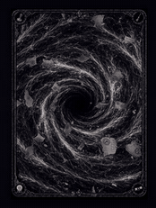
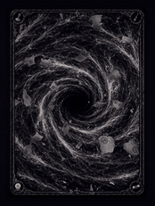

<table align="center" width="100%">
  <tr>
    <td align="center" valign="middle" width="22%">
      
    </td>
    <td align="center" valign="middle" width="56%">
      <h2>Paranoidgrinch</h2>
      
Game systems and scientific software.

      
I write a deterministic engine for roguelike deckbuilders, and the software that runs and models a laser-assisted accelerator mass spectrometry experiment at CologneAMS.

      
<a href="https://moonvineforge.com">Moonvine Forge Studios</a> · <a href="https://studio.moonvineforge.com">RogueDeck Studio</a>

    </td>
    <td align="center" valign="middle" width="22%">
      
    </td>
  </tr>
</table>

## Games

### [RogueDeck Core](https://github.com/Paranoidgrinch/RogueDeck-Core)

A deterministic C#/.NET engine for roguelike deckbuilders, independent of any game UI. Mechanics are
composed from effect programs and typed events instead of card-specific special cases. The same seed and the
same decisions always produce the same run, so runs can be snapshotted, hashed, replayed and tested.

- Combat: effects, triggers, targeting, statuses, resources, modifier and interceptor pipelines
- Runs: characters, decks, relics, encounters, events, shops, generated multi-act maps, meta progression
- Tooling: scenario DSL, a bot that plays and replays whole runs, about 2,700 tests in CI

### [RogueDeck Studio](https://studio.moonvineforge.com)

A browser editor for building a roguelike deckbuilder without writing code. Cards, characters, enemies,
encounters, relics, events, shops and maps are authored in the browser, played on the real engine, and
exported as a versioned JSON blueprint that a RogueDeck host can run.

### Bureaucrats & Broomsticks

A satirical fantasy roguelike deckbuilder in five acts, built on RogueDeck. The game is split across four
repositories:

| Repository | Content |
| --- | --- |
| [RogueDeck-Core](https://github.com/Paranoidgrinch/RogueDeck-Core) | combat and run engine, bot, replay |
| [bnb-content](https://github.com/Paranoidgrinch/bnb-content) | the game content, converted and validated into `game.roguedeck.json` |
| [bnb-godot](https://github.com/Paranoidgrinch/bnb-godot) | Godot 4 (.NET) frontend |
| [bnb-runs](https://github.com/Paranoidgrinch/bnb-runs) | recorded playtest runs (seed and decisions), replayable step by step |

The first version was a [Python terminal prototype](https://github.com/Paranoidgrinch/bureaucrats-and-broomsticks-v2)
with hardcoded mechanics. Its limits are the reason RogueDeck exists.

## Science

My research at CologneAMS is on laser-assisted accelerator mass spectrometry. For ²⁶Al AMS I investigate
selective photodetachment of the interfering MgO⁻ while transmitting AlO⁻, using a helium-filled RFQ ion
cooler and a 532 nm continuous-wave laser. The difficulty is suppressing the molecular isobar without losing
the ions the measurement needs.

I model collision-induced losses and ion transport in the RFQ, simulate electrostatic ion optics in SIMION,
evaluate ion–laser overlap and beamline transmission, and write the control and analysis software for the
experiment.

### [OpenEA Benchmark](https://github.com/Paranoidgrinch/openea-benchmark)

Photodetachment depends on the electron affinity of the anion, and for most diatomic molecules it has never
been measured. OpenEA computes the adiabatic electron affinity EA₀ of a diatomic molecule from its two element
symbols, without manual choices or reference data.

It finds the competing electronic states of neutral and anion, computes CCSD(T) potential curves, extrapolates
to the complete-basis-set limit, and adds core-valence, relativistic, spin–orbit, post-CCSD(T), multireference
and zero-point corrections where the diagnostics require them. The result is an interval derived from the
computed sensitivities, `UNBOUND`, or `UNRESOLVED` with the reason.

| | OH | CN | NO | O₂ | ClO | AlO | C₂ | N₂ |
| --- | --- | --- | --- | --- | --- | --- | --- | --- |
| OpenEA (eV) | 1.828 | 3.861 | 0.022 | 0.444 | 2.279 | 2.613 | 3.286 | unbound |
| Experiment (eV) | 1.828 | 3.862 | 0.026 | 0.448 | 2.276 | 2.60 | 3.269 | unbound |

Built on PySCF, CCpy and OpenMolcas. Transition-metal and heavy-element molecules are the next validation
step. The predecessor, [DiatomicEA](https://github.com/Paranoidgrinch/diatomic-ea), estimates EAs from a fixed
DFT ensemble; it is fast but limited by DFT.

### [FLAVIA](https://github.com/Paranoidgrinch/FLAVIA-alpha-1.1-Fully-integrated-Laser-Anion-Variables-for-AMS-)

The control system of the beamline I work on. One PyQt5 application controls the ion source, ion optics,
analyzing magnet, RFQ ion cooler, Faraday cups, current measurement, vacuum and the legacy Tandetron
controls over MQTT (Beckhoff PLC), TCP/IP and serial links. It records 1D and 2D beam scans and saves and
restores complete machine configurations.

### [Gaussian Beamline Designer](https://github.com/Paranoidgrinch/Gaussian-Beamline-Designer)

A PyQt5 application for paraxial laser-beam design. It propagates elliptical Gaussian beams separately in x
and y through lenses, mirrors, apertures and beam tubes using ABCD matrices, with JSON projects and CSV/PNG
export. Version 1.0.0 is released.

### Smaller lab tools

| Project | Purpose |
| --- | --- |
| [SIRIUS](https://github.com/Paranoidgrinch/SIRIUS), [mcsirius](https://github.com/Paranoidgrinch/mcsirius) | automated beam tuning on top of FLAVIA (whole beamline / source to Cup 1) |
| [VerdiV18](https://github.com/Paranoidgrinch/VerdiV18) | remote control and monitoring of the 532 nm CW laser |
| [LC-Circuit-flashing](https://github.com/Paranoidgrinch/LC-Circuit-flashing) | LC matching of the RFQ via Raspberry Pi |
| [Beckhoff-CX7080-MQTT](https://github.com/Paranoidgrinch/Beckhoff-CX7080-MQTT) | TwinCAT PLC programs that expose the ion-cooler power supplies over MQTT |

## Tools

| Area | |
| --- | --- |
| Game systems | C#, .NET 10, Godot 4, Blazor WebAssembly, GitHub Actions |
| Scientific computing | Python, PySCF, CCpy, OpenMolcas, NumPy, SIMION, Lua, PyQt5 |
| Instrumentation | TwinCAT 3, IEC 61131-3, LabVIEW, MQTT, Raspberry Pi, serial, TCP/IP |
