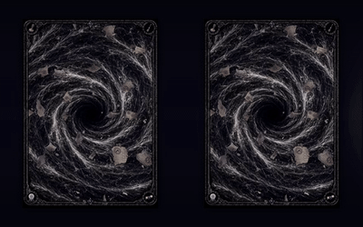
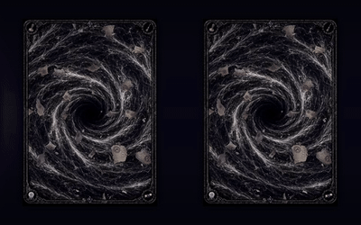

<!-- Profile hero: animated card pairs cropped from the original five-card MP4. -->
<table align="center" width="100%">
  <tr>
    <td align="center" valign="middle" width="27%">
      
    </td>
    <td align="center" valign="middle" width="46%">
      <h2>Hi, I'm <a href="https://github.com/Paranoidgrinch">@Paranoidgrinch</a></h2>
      
<strong>Game systems & scientific software</strong>

      
I build deterministic game engines, simulate ion beams and molecular electronic structure, and write software for laboratory hardware.

      

        <a href="https://moonvineforge.com"><strong>Moonvine Forge Studios</strong></a>
      

      
       
      
    </td>
    <td align="center" valign="middle" width="27%">
      
    </td>
  </tr>
</table>

  

---

## RogueDeck

### [RogueDeck Core](https://github.com/Paranoidgrinch/RogueDeck-Core)

**A deterministic C#/.NET engine for roguelike deckbuilders, independent of any game UI.**

The engine resolves mechanics through composable effect programs and typed events rather than a growing collection of card-specific exceptions. Seeded runs, snapshots and replay make game states reproducible; versioned content and a Godot/.NET host connect the engine to playable games.

- **Combat:** effects, triggers, targets, statuses, resources and modifier/interceptor pipelines.
- **Runs:** parties, relics, encounters, shops, branching maps and progression.
- **Engineering:** automated tests, scenario tooling and replayable runs.

### [RogueDeck Studio](https://studio.moonvineforge.com)

**Build and playtest a deckbuilder in your browser, without writing code.** Create cards, characters, enemies, encounters, relics, shops and maps; test their interactions; export the result as a versioned JSON blueprint for a RogueDeck host.

[**Open RogueDeck Studio →**](https://studio.moonvineforge.com)

RogueDeck grew out of <a href="https://github.com/Paranoidgrinch/bureaucrats-and-broomsticks-v2">Bureaucrats &amp; Broomsticks</a>, my playable Python roguelike prototype.

---

## Science & engineering

My research at **CologneAMS** brings together ion-beam physics, high-power lasers and experimental control software. I work on the parts of an experiment that have to agree in practice: particle trajectories, optical alignment, measured transmission and reliable instrument control.

### Laser-assisted accelerator mass spectrometry

For **²⁶Al AMS**, I investigate selective photodetachment of interfering **MgO⁻** while transmitting **AlO⁻**. The experiment combines a helium-filled RFQ ion cooler with a continuous-wave **532 nm laser**. The central trade-off is suppressing molecular isobars without losing the ions needed for the measurement.

I model collision-induced losses and ion transport through the RFQ, simulate electrostatic ion optics in **SIMION**, and evaluate ion–laser overlap, apertures and beamline transmission. On the instrumentation side, I develop tools for laser operation, RF matching and coordinated beamline control.

### [OpenEA Benchmark](https://github.com/Paranoidgrinch/openea-benchmark) — in development

**An open-source, state-aware workflow for high-accuracy electron affinities of diatomic molecules.** Instead of assuming one electronic state or averaging a fixed set of methods, OpenEA is being designed to follow competing neutral/anion states and escalate the calculation only when diagnostics justify it.

The scientific roadmap covers electronic-state discovery and continuity along potential-energy curves; correlated energies and basis-set convergence; nuclear-motion, relativistic and spin–orbit contributions; and an uncertainty-aware **EA / UNBOUND** decision. **FeH/FeH⁻ is a demanding validation case, not a molecule-specific target.**

The repository documents verified software capabilities using **PySCF/CCpy** (higher-order coupled cluster) and **OpenMolcas** (multireference methods and spin–orbit coupling). The final predictive method and its uncertainty policy are **not yet frozen**.

[**Explore OpenEA Benchmark →**](https://github.com/Paranoidgrinch/openea-benchmark)

### [Gaussian Beamline Designer](https://github.com/Paranoidgrinch/Gaussian-Beamline-Designer)

**A released PyQt5 application for paraxial laser-beam design.** It propagates elliptical Gaussian beams independently in x and y through lenses, mirrors, apertures and beam tubes using ABCD optics. The interface visualizes beam size and constraints, with reproducible JSON projects and CSV/PNG exports.

### Laboratory control software

My control stack spans **Python/PyQt5**, **Beckhoff TwinCAT / IEC 61131-3 Structured Text**, **LabVIEW** and serial/TCP/IP/MQTT device communication. Some of the public projects behind it:

| Project | What it does |
| --- | --- |
| [**FLAVIA**](https://github.com/Paranoidgrinch/FLAVIA-alpha-1.1-Fully-integrated-Laser-Anion-Variables-for-AMS-) | Python control interface integrating tools for laser–anion AMS experiments. |
| [**Verdi V18 Controller**](https://github.com/Paranoidgrinch/VerdiV18) | Remote control and monitoring for a high-power continuous-wave laser. |
| [**RFQ resonance control**](https://github.com/Paranoidgrinch/LC-Circuit-flashing) | Raspberry Pi software to adjust resonant LC matching in the RFQ system. |
| [**Beckhoff CX7080 + MQTT**](https://github.com/Paranoidgrinch/Beckhoff-CX7080-MQTT) | PLC-side integration and MQTT communication. |

---

## Toolset

| Area | Languages, frameworks & tools |
| --- | --- |
| **Game systems** | C#, .NET 10, Godot, Blazor, Python, JSON, GitHub Actions |
| **Scientific computing** | Python, PySCF, CCpy, OpenMolcas, NumPy, SIMION, Lua, PyQt5 |
| **Instrumentation** | TwinCAT 3, IEC 61131-3, LabVIEW, MQTT, Raspberry Pi, serial, TCP/IP |

  I like building systems that can be tested and understood — whether they process combat events or steer ions through an accelerator. 
  <a href="https://studio.moonvineforge.com">RogueDeck Studio</a> ·
  <a href="https://moonvineforge.com">Moonvine Forge</a> ·
  <a href="https://github.com/Paranoidgrinch">GitHub</a>

